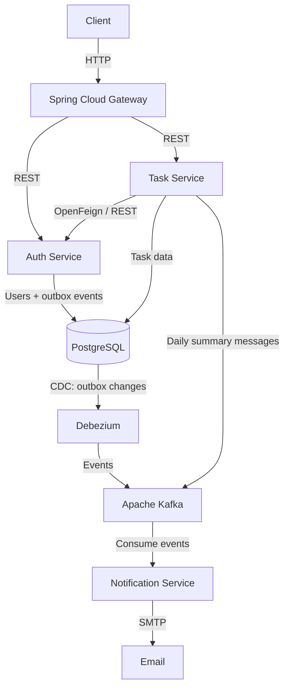

# Task Tracker

A microservices-based task management application built with **Java, Spring Boot, React, and Apache Kafka**. The project demonstrates service-oriented backend design, OAuth2/JWT security, synchronous and asynchronous communication, and reliable event publishing with the **Transactional Outbox pattern and Debezium CDC**.

## Technology Stack

[//]: # (| Frontend | React, Vite |)

| Area | Technologies |
| --- | --- |
| Backend | Java, Spring Boot, Spring MVC, Spring Data JPA, Hibernate |
| Security | Spring Security, OAuth2, JWT |
| API & communication | REST, Spring Cloud Gateway, OpenFeign |
| Messaging | Apache Kafka |
| CDC & reliability | Debezium, Transactional Outbox |
| Database | PostgreSQL, Liquibase |
| Infrastructure | Docker, Docker Compose |
| Automation | GitHub Actions |
| Email | SMTP |

## Features

- Create, view, update, and delete tasks.
- Register and authenticate users using OAuth2 and JWT.
- Access backend APIs through a Spring Cloud Gateway entry point.
- Generate scheduled daily task summaries.
- Deliver welcome emails and task-related notifications asynchronously.
- Handle Kafka consumer failures with retries, dead-letter topics, and message deduplication.

## Architecture



### Services

[//]: # (| **Frontend** &#40;`tracker-front`&#41; | React user interface for interacting with the application. |)

| Component | Responsibility |
| --- | --- |
| **API Gateway** (`tracker-gateway`) | Routes client requests, configures CORS, and supports OAuth2/JWT security. |
| **Auth Service** (`tracket-auth-service`) | Manages users, authentication, token issuance, and registration events. |
| **Task Service** (`task-service`) | Implements task CRUD operations, task persistence, and scheduled reports. |
| **Notification Service** (`tracker-notification-service`) | Consumes Kafka messages and sends email notifications. |

## Communication Patterns

### Synchronous: REST and OpenFeign

The client sends requests through the API Gateway. The Gateway forwards task requests to the Task Service and authentication-related requests to the Auth Service. The Task Service also uses **OpenFeign** to retrieve user information from the Auth Service when generating reports.

### Asynchronous: Kafka

Notification delivery is decoupled from user-facing HTTP requests. Services publish events or notification messages to Kafka, which the Notification Service consumes and processes independently.

### Reliable Event Publishing: Transactional Outbox + Debezium

User registration illustrates the event-driven flow:

1. The Auth Service persists a new user and an outbox event in PostgreSQL.
2. Debezium captures the outbox change using Change Data Capture (CDC).
3. The event is published to Apache Kafka.
4. The Notification Service consumes the registration event.
5. A welcome email is sent through SMTP.

Writing the business record and its outbox event in the same database transaction avoids the classic **dual-write inconsistency** between database persistence and direct broker publishing. Downstream consumers must still account for possible duplicate deliveries.

### Scheduled Task Summaries

The Task Service runs a scheduled job that retrieves users via OpenFeign, aggregates their tasks by status, and publishes summary notifications to Kafka. The Notification Service processes these messages and sends email reports.

## Security

- **Spring Security** integrates OAuth2 and JWT-based authentication.
- The **Auth Service** handles user authentication and token issuance.
- The **Gateway** provides request routing and JWT resource-server support.
- The **Task Service** independently requires authentication for its endpoints.

> **Security note:** In the supplied Gateway configuration, `/api/**` is permitted without mandatory authentication at the Gateway layer. The Task Service applies its own authentication requirement. Gateway routing should not be mistaken for complete endpoint-level authorization.

## Running Locally

### Prerequisites

- Docker and Docker Compose
- Git
- Environment variables and credentials for the application services, database, and SMTP integration

### 1. Get the source

```bash
git clone --recurse-submodules https://github.com/nicolahater/task-tracker.git
cd task-tracker
```

### 2. Configure the environment

The repository contains example environment files for the root configuration and individual backend services. Create the corresponding environment files and provide your local credentials and service settings before starting the containers.

The local-build Compose configuration expects files such as `.env.docker` at the root and in individual backend service directories. These files are **not included** in the supplied archive, so they must be prepared first.

### 3. Build and start the services

```bash
docker compose -f docker-compose.docker.yml up --build -d
```

The Docker Compose configuration starts the application services together with PostgreSQL, Kafka, ZooKeeper, and Debezium.

### 4. Open the application

- Frontend: **http://localhost:3001**
- API Gateway: **http://localhost:8080**

### 5. Stop the application

```bash
docker compose -f docker-compose.docker.yml down
```

To remove persistent database and Debezium volumes as well, use `down -v` (this deletes local persisted data).

## API Overview

All requests go through the gateway (`http://localhost:8080`).

### Auth

| Method | Path | Description |
|---|---|---|
| POST | `/api/auth/register` | Register a user (also emits the `USER_REGISTERED` outbox event) |
| POST | `/api/auth/login` | Log in with username and password, returns a JWT |
| GET | `/api/auth/users` | List users (used by the Task Service for reports) |

### Tasks (JWT required)

| Method | Path | Description |
|---|---|---|
| GET | `/api/tasks` | List tasks |
| POST | `/api/tasks` | Create a task (starts in `NEW`) |
| PUT | `/api/tasks/{id}` | Update title, description and status |
| DELETE | `/api/tasks/{id}` | Delete a task |

Task statuses: `NEW`, `IN_PROGRESS`, `COMPLETED`.

## Engineering Highlights

- **Clear service boundaries:** authentication, task management, and notifications are implemented as separate services.
- **Mixed communication model:** REST/OpenFeign for immediate responses, Kafka for background processing.
- **Reliable integration events:** the Transactional Outbox pattern and Debezium CDC address database/broker dual-write inconsistencies.
- **Resilient consumers:** retry and dead-letter handling help isolate failed notification processing.
- **Containerized development:** Docker Compose runs the application and supporting infrastructure together.

